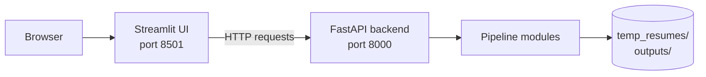
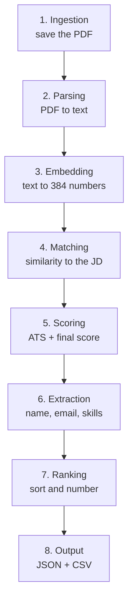

# Beginner's Guide: AI Resume Shortlister

A learning-oriented walkthrough of how this project works, why it is built the way it is, and how to extend it. No prior AI experience is required; basic Python familiarity helps from Section 5 onward.

> **Looking for install and API reference?** See the [README](README.md). This guide explains *concepts and design*; the README covers *setup and usage*.

**Estimated reading time:** 45–60 minutes. **Hands-on exercises:** [Section 11](#11-exercises).

---

## Contents

1. [The problem and the idea](#1-the-problem-and-the-idea)
2. [The big picture](#2-the-big-picture)
3. [Concepts you need first](#3-concepts-you-need-first)
4. [Run it and see it work](#4-run-it-and-see-it-work)
5. [Following one resume through the pipeline](#5-following-one-resume-through-the-pipeline)
6. [Module-by-module tour](#6-module-by-module-tour)
7. [Scoring: a worked example](#7-scoring-a-worked-example)
8. [Technology choices](#8-technology-choices)
9. [Design decisions and trade-offs](#9-design-decisions-and-trade-offs)
10. [Known limitations (and why they matter)](#10-known-limitations-and-why-they-matter)
11. [Exercises](#11-exercises)
12. [Troubleshooting](#12-troubleshooting)
13. [Glossary](#13-glossary)
14. [Where to go next](#14-where-to-go-next)

---

## 1. The problem and the idea

A job posting can attract hundreds of resumes. Someone has to open each PDF, compare it with the job description, and pick a shortlist. Done by hand this is slow, and judgment drifts as fatigue sets in.

**This project automates the first pass.** You provide:

- a set of resume PDFs
- a job description (plain text)

It returns:

- a ranked list of candidates with a score from 0 to 100
- extracted contact details and skills
- the keywords each candidate matched and missed
- a downloadable CSV

It is a **screening aid**. A person should still read the shortlisted resumes, and should look at low-scoring ones when something seems off.

### The core idea: two independent opinions

| Opinion | Method | Strength | Weakness |
|---------|--------|----------|----------|
| **Semantic similarity** | AI embeddings + cosine similarity | Understands that "Python developer" and "Python programmer" are close | Hard to explain; can reward well-written but unqualified resumes |
| **ATS score** | Fixed rules and keyword counts | Fully explainable and repeatable | Blind to synonyms and context |

The final score blends them, so each covers the other's blind spots.

---

## 2. The big picture

The project is two programs that talk over HTTP:

- **Backend** (FastAPI) does all the work.
- **Frontend** (Streamlit) is the web page you click on.



Inside the backend, a resume passes through eight stages:



**Rule of thumb:** one folder = one stage = one responsibility.

---

## 3. Concepts you need first

Skim this section now; return to it when a term feels unfamiliar.

### 3.1 APIs and HTTP

An **API** is a set of "doors" a program exposes so other programs can ask it to do things. Each door is an **endpoint**, such as `/api/upload`. HTTP defines how to knock:

| Verb | Meaning | Example here |
|------|---------|--------------|
| `GET` | Give me data | `GET /api/results` |
| `POST` | Here is data; act on it | `POST /api/upload` |
| `DELETE` | Remove something | `DELETE /api/cleanup` |

`localhost:8000` means "port 8000 on this computer". A **port** is just a numbered door; the backend uses 8000 and the UI uses 8501.

### 3.2 Embeddings: turning meaning into numbers

Computers compare numbers, not meaning. An **embedding model** reads text and outputs a fixed-length list of numbers (a **vector**) so that texts with similar meaning get similar vectors.

```
"Python developer"   → [ 0.12, -0.34,  0.87, ... ]   384 numbers
"Python programmer"  → [ 0.11, -0.31,  0.85, ... ]   close to the first
"Pastry chef"        → [-0.52,  0.20, -0.11, ... ]   far from both
```

(The numbers above are illustrative.)

Why not just count shared words? "Python developer" and "Python programmer" share one word, yet mean nearly the same thing. Conversely, "no experience in Python" and "Python experience required" share many words but say opposite things about a candidate. Embeddings capture much of this context; word counting cannot.

### 3.3 Cosine similarity

Treat each vector as an arrow. **Cosine similarity** measures the angle between two arrows:

- same direction → close to `1.0`
- unrelated → close to `0.0`

If every vector is first scaled to length 1 (**L2 normalization**, which this project does), then the plain **dot product** of two vectors *equals* their cosine similarity. That is why the code uses FAISS's inner-product index.

### 3.4 Regular expressions (regex)

A **regex** is a compact pattern for finding text. The project uses regex to find things with predictable shapes:

```python
r'[\w.+-]+@[\w-]+\.[\w.-]+'      # something@something.something  → an email address
```

Regex is a good fit here because emails, phone numbers, and degree names follow patterns. It is a poor fit for fuzzy things like a person's name, which is why name extraction is a heuristic (Section 6).

### 3.5 ATS

An **Applicant Tracking System** is software recruiters use to filter resumes. Real products vary widely. In this project, "ATS score" means *our own simple rubric*, explained in Section 7.

---

## 4. Run it and see it work

Follow the [README Quick start](README.md#quick-start), then:

1. Start the backend and frontend in two terminals.
2. Open http://localhost:8501. The sidebar should show **API Connected**.
3. Upload two or three PDF resumes (use your own or any sample resumes you have permission to use).
4. Paste a short job description, for example: *"Python developer with 3 years of experience in machine learning, NLP, and AWS."*
5. Click **Process & Rank Candidates**.

**What to expect**

- The first run is slower: the ~80 MB embedding model is downloaded, then loaded.
- Each candidate gets three numbers: similarity, ATS, and final.
- Expanding a candidate shows matched and missing keywords. Compare these with the resume itself to build intuition for how scoring behaves.

**Also try** http://localhost:8000/docs. FastAPI generates an interactive page where you can call every endpoint without writing code.

---

## 5. Following one resume through the pipeline

Take `alice.pdf`. Here is exactly what happens, with the data shape at each step. The orchestration lives in `process_resumes()` in `main.py`.

### Stage 1 — Ingestion (`ingestion/upload.py`)

The UI sends the file to `POST /api/upload`. The backend skips anything not ending in `.pdf`, then calls `save_resume(bytes, filename)`, which writes the file to `temp_resumes/alice.pdf` and returns its path.

### Stage 2 — Parsing (`parsing/parser.py`)

A PDF is not a text file; it stores fonts, coordinates, and drawing instructions. PyMuPDF reads that structure and returns the visible text.

```python
doc = fitz.open(pdf_path)
text = "".join(page.get_text() for page in doc)
```

If the file is corrupt, encrypted, or image-only, the function catches the error and returns `""`. The pipeline skips empty results, so **one bad file never stops the batch.**

*Shape:* `str` (the whole resume as plain text).

### Stage 3 — Embedding (`embeddings/embedder.py`)

The resume text is converted to a 384-number vector. The job description gets one too.

- `get_model()` loads the model **once** and caches it (the *singleton* pattern). Loading takes seconds and hundreds of MB of RAM; reloading per resume would be wasteful.
- `generate_embeddings_batch(texts)` encodes all resumes together, which is faster than a loop.
- `normalize_embeddings=True` makes every vector length 1 (needed for the cosine trick above).
- The result is converted to `float32`, the type FAISS requires.

*Shape:* `(n_resumes, 384)` for the batch, `(384,)` for the JD.

> **Important:** this model reads only roughly the first 200 words of its input (it truncates at about 256 word-pieces). See [Section 10](#10-known-limitations-and-why-they-matter).

### Stage 4 — Matching (`matching/matcher.py`)

All resume vectors go into a FAISS `IndexFlatIP` ("flat" = exact search, "IP" = inner product). The JD vector is the query. FAISS returns scores sorted best-first, together with the original positions (`indices`).

`main.py` needs scores in **upload order**, so `match_resumes_to_job()` re-maps them:

```
Upload order:   alice(0), bob(1), carol(2)
FAISS returns:  scores=[0.61, 0.55, 0.40]  indices=[2, 0, 1]
                → carol=0.61, alice=0.55, bob=0.40
Re-mapped:      [0.55, 0.40, 0.61]   (alice, bob, carol)
```

*Shape:* `list[float]`, one similarity per resume.

### Stage 5 — Scoring (`scoring/scorer.py`)

Two functions:

- `calculate_ats_score(resume_text, jd_text)` → dictionary with `ats_score`, `matched_keywords`, `missing_keywords`, `sections_found`, `keyword_score`, `word_count`.
- `calculate_final_score(similarity, ats)` → blends them (details in Section 7).

### Stage 6 — Extraction (`extraction/extractor.py`)

`extract_all(text)` runs six small extractors and bundles the results:

| Function | Technique |
|----------|-----------|
| `extract_email` | One regex; first match |
| `extract_phone` | Four regexes tried in order (international, Indian grouping, plain digits, US) |
| `extract_name` | Heuristic: among the first 7 lines, skip headers (`Resume`, `CV`), lines with `@`, long digit runs, URLs, or contact labels; take the first line of 1–5 alphabetic words |
| `extract_skills` | Case-insensitive lookup against `KNOWN_SKILLS`; deduplicated and sorted |
| `extract_education` | Four degree regexes (bachelor's, master's, doctorate, diploma/certificate); max 5 entries, 80 chars each |
| `extract_experience_years` | Two regexes for "5 years of experience" and "experience of 5 years"; otherwise `"Not specified"` |

### Stage 7 — Ranking (`ranking/ranker.py`)

```python
sorted(candidates, key=lambda c: c.get("final_score", 0), reverse=True)
```

then `enumerate(..., start=1)` adds a `rank` field. The module also provides `get_top_candidates()` and `get_shortlisted()` helpers.

### Stage 8 — Output

`main.py` stores the ranked list in `state.results`, writes `outputs/results.csv`, and returns JSON. Streamlit renders cards or a table. The CSV flattens the `skills` list into one comma-separated string because a CSV cell cannot hold a list.

---

## 6. Module-by-module tour

### 6.1 Why every package has an `__init__.py`

Python only treats a folder as an importable **package** when it contains `__init__.py`. Without `embeddings/__init__.py`, the line `from embeddings.embedder import ...` in `main.py` fails with `ModuleNotFoundError`. These files are intentionally almost empty.

### 6.2 `ingestion/upload.py`

| Function | Purpose |
|----------|---------|
| `ensure_directories()` | Create `temp_resumes/` and `outputs/` if missing (`parents=True, exist_ok=True`) |
| `save_resume(bytes, filename)` | Write bytes to `temp_resumes/<filename>` in binary mode; return the path |
| `get_all_resumes()` | `glob("*.pdf")` over `temp_resumes/` |
| `cleanup_temp()` | Delete the folder tree, then recreate it empty |

Paths are built from `Path(__file__).resolve().parent.parent`, so the project works from any location without hard-coded absolute paths.

### 6.3 `parsing/parser.py`

`extract_text_from_pdf(path)` and `extract_text_from_bytes(bytes)` share the same logic. The second reads from memory (`fitz.open(stream=..., filetype="pdf")`) and is available for a future fully in-memory flow.

### 6.4 `embeddings/embedder.py`

`get_model()`, `generate_embedding(text)`, `generate_embeddings_batch(texts)`, as described in Stage 3.

### 6.5 `matching/matcher.py`

| Function | Purpose |
|----------|---------|
| `compute_cosine_similarity(a, b)` | Direct formula with a zero-vector guard; handy for tests and debugging |
| `build_faiss_index(embeddings)` | Create `IndexFlatIP(dim)` and add vectors |
| `search_similar(index, query, top_k)` | Reshape query to `(1, dim)`, search, return `scores[0], indices[0]` |
| `match_resumes_to_job(resume_embs, jd_emb)` | Build index, search all, re-map to upload order, round to 4 decimals |

### 6.6 `scoring/scorer.py`

Holds `SKILL_KEYWORDS` (lowercase, roughly 60 terms across languages, ML, cloud, databases, and soft skills) plus the three functions in Stage 5. Keywords are lowercase so comparison needs only a single `.lower()` on the input text.

### 6.7 `main.py`

- **`AppState`**: holds `job_description`, `results`, and `is_processing`. HTTP requests are independent, so this in-memory object is how the JD set in one request is available to the next.
- **`lifespan`**: code before `yield` runs at server start (`ensure_directories()`), code after at shutdown.
- **Endpoints**: see the [API reference](README.md#api-reference).
- **`try/finally` in `/api/process`**: the `finally` block resets `is_processing`, so one crash cannot lock the server forever.
- **`CORSMiddleware`**: allows the browser-side UI to call the API from a different origin.

### 6.8 `ui/app.py`

A single Streamlit script of about 500 lines.

- **Rerun model:** Streamlit re-executes the whole script on every interaction. Values that must survive (like results) go in `st.session_state`.
- **Helpers:** `check_api()`, `upload_files()`, `set_jd()`, `process()`, `get_results()`, `cleanup()`, each a thin wrapper over `requests`.
- **Process button:** disabled unless files, JD text, and API connectivity are all present.
- **Views:** cards (faded when below the threshold) or a pandas table with progress-bar columns.
- **Threshold slider:** purely visual; it does not delete or filter data.

---

## 7. Scoring: a worked example

### ATS score

```
ATS = keyword_score × 0.60 + section_score × 0.20 + length_score × 0.10 + format_score × 0.10
```

| Component | Calculation | Value |
|-----------|-------------|------:|
| Keywords | 7 of 10 JD keywords found → 70 | 70 |
| Sections | education, experience, skills, contact all present → 100 | 100 |
| Length | 450 words (in 200–1000) | 100 |
| Format | email and phone both present | 100 |

`ATS = 70×0.6 + 100×0.2 + 100×0.1 + 100×0.1 = 42 + 20 + 10 + 10 = 82`

### Final score

```
final = similarity × 100 × 0.6 + ATS × 0.4
```

With similarity `0.52`:

`final = 52 × 0.6 + 82 × 0.4 = 31.2 + 32.8 = 64.0`

### How to read it

- Embedding similarity between a resume and a JD is usually **moderate** even for good matches. Do not expect values near 0.9.
- Compare candidates **within the same batch**; the absolute number is not a probability.
- The 60/40 weights are a reasonable starting point, not a tuned optimum. Try different weights on resumes where you already know the right order, and see what happens (Exercise 2).

---

## 8. Technology choices

For each tool: what it does here, and what the realistic alternatives are. "Best" depends on context; these are the reasons it fits *this* project.

| Tool | Role in this project | Why it fits | Reasonable alternatives |
|------|---------------------|-------------|-------------------------|
| **Python** | Everything | The ML/NLP ecosystem is Python-first; readable for learners | Node.js or Java work for the API, but lack equivalent embedding tooling |
| **FastAPI** | Backend API | Type hints drive validation, automatic `/docs`, async-ready | Flask (simpler, fewer built-ins), Django (heavier, full-stack) |
| **Uvicorn** | Runs FastAPI | The standard ASGI server recommended in FastAPI's docs; `--reload` for development | Hypercorn, Gunicorn with Uvicorn workers (common in production) |
| **Streamlit** | UI | Build dashboards in pure Python; ideal for data tools | Gradio (faster demos, less layout control), React (most flexible, much more code) |
| **PyMuPDF** | PDF text | Fast and robust text extraction | pypdf, pdfplumber, pdfminer.six; add Tesseract OCR for scans |
| **sentence-transformers** | Embeddings API | One-line access to strong pre-trained sentence models | OpenAI or other hosted embeddings (cost, network, privacy trade-offs) |
| **all-MiniLM-L6-v2** | The model | Small (~80 MB), fast on CPU, good quality for semantic similarity | `all-mpnet-base-v2` (larger, usually more accurate, slower) |
| **PyTorch** | Neural-network runtime | Required backend of sentence-transformers; you never call it directly | — |
| **FAISS** | Vector search | Exact inner-product search, scales well if the project grows | NumPy dot product (equally correct at small scale), scikit-learn |
| **NumPy** | Arrays | The common format for all the above | — |
| **pandas** | Table view | `st.dataframe` and `column_config` integrate directly | Plain lists of dicts for simple cases |
| **requests** | UI → API calls | Simple synchronous HTTP client | httpx |
| **python-multipart** | Form parsing | Required by FastAPI for `UploadFile` | — |
| **`re`** | Extraction | Built-in; ideal for structured patterns | spaCy NER or an LLM for fuzzy entities (more capable, heavier) |

**A note on FAISS.** For a few hundred resumes, a plain NumPy matrix product gives identical results in microseconds. FAISS is here for headroom and as a practical introduction to vector indexes. The repository also contains a direct cosine function for exactly this comparison.

**About the model.** `all-MiniLM-L6-v2` is a compact model from the sentence-transformers project, built on Microsoft's MiniLM and fine-tuned on a very large set of sentence pairs. It outputs 384-dimensional vectors.

---

## 9. Design decisions and trade-offs

**Separate frontend and backend.** The UI only needs HTTP, so you can swap Streamlit for another client, test the API alone with `/docs` or curl, or host the two on different machines. The cost is two processes to start.

**One package per stage.** Easy to find code ("how does matching work?" → `matching/`), easy to test in isolation, easy to replace (add a DOCX parser without touching scoring). The cost is more files.

**In-memory state, no database.** The tool is designed for one person working through one job posting at a time. A database would add setup and migrations for no benefit in that scenario. The cost: restart the server and state is gone; two users would share one `AppState`.

**Hybrid scoring instead of one method.**
- Embeddings alone can favor a fluent resume that lacks the required tools.
- Keywords alone can be fooled by a resume that merely *lists* terms, and miss synonyms.
- Blending trades some simplicity for robustness and explainability.

**Regex instead of an ML extractor.** Emails and phones have fixed shapes, so regex is fast, dependency-free, deterministic, and cannot hallucinate. The cost is brittleness on unusual layouts (names especially).

**Local-first processing.** Resume data never leaves the machine, which matters for personal data. The cost is a larger install (PyTorch) and CPU-bound inference.

---

## 10. Known limitations (and why they matter)

Understanding limits is part of understanding the system. Each of these is also a good improvement project.

| Limitation | Why it happens | What you would change |
|-----------|----------------|-----------------------|
| **Only the start of each resume is embedded** | The model truncates at about 256 word-pieces (roughly 200 words) | Split the resume into chunks, embed each, then average or take the maximum similarity |
| **`java` matches `javascript`** (and short terms like `go` can match inside other words) | Keywords are tested with `kw in text_lower` | Use word-boundary regex such as `\bjava\b` |
| **"ML" is not "Machine Learning" in the keyword score** | Keywords are literal strings | Add a synonym map before matching |
| **Scanned PDFs return nothing** | PyMuPDF reads embedded text only | Add OCR (for example Tesseract) as a fallback |
| **Name sometimes wrong** | Heuristic on the first seven lines | Try an NER model, or fall back to the file name |
| **Same filename overwrites** | Files are saved under the uploaded name | Prefix a unique ID |
| **Crafted filenames can escape the folder** | `TEMP_DIR / filename` trusts the name (for example `../x.pdf`) | Use `Path(filename).name` and validate |
| **Old resumes reappear** | Processing reads every PDF in `temp_resumes/` | Clear data between jobs, or scope files per session |
| **Two users interfere** | One global `AppState`, no auth | Per-session state and authentication |
| **Scores can look low** | Cosine similarity rarely approaches 1.0 for long documents | Interpret relatively; consider rescaling within the batch |

---

## 11. Exercises

Each exercise touches one module, so you can learn the code by changing it.

**1. Add a skill (easy).** Add `"figma"` to `SKILL_KEYWORDS` and `"Figma"` to `KNOWN_SKILLS`. Upload a resume mentioning it and confirm it appears in both matched keywords and skill tags.

**2. Experiment with weights (easy).** Change the 60/40 split to 50/50 and 80/20. With three resumes whose true order you know, which setting ranks them best? Note what you learn about each signal.

**3. Fix the `java` false positive (medium).** In `scoring/scorer.py`, replace the substring test with word boundaries:

```python
import re

def extract_keywords(text: str) -> list:
    text_lower = text.lower()
    return [
        kw for kw in SKILL_KEYWORDS
        if re.search(rf"(?<!\w){re.escape(kw)}(?!\w)", text_lower)
    ]
```

Using lookarounds instead of `\b` handles terms like `c++` and `c#`, where `\b` behaves unexpectedly. Test with a text containing only "JavaScript".

**4. Sanitize uploads (medium).** In `save_resume`, build the path from `Path(filename).name`. Write down why this blocks a file named `../../evil.pdf`.

**5. Write your first tests (medium).** Create `tests/test_ranker.py`:

```python
from ranking.ranker import rank_candidates

def test_rank_orders_by_final_score():
    data = [
        {"name": "Jane", "final_score": 72.4},
        {"name": "Bob",  "final_score": 91.2},
        {"name": "John", "final_score": 85.0},
    ]
    ranked = rank_candidates(data)
    assert [c["name"] for c in ranked] == ["Bob", "John", "Jane"]
    assert [c["rank"] for c in ranked] == [1, 2, 3]
```

Install pytest (`pip install pytest`) and run `pytest`. Then write similar tests for `extract_email` and `calculate_final_score`.

**6. Fix the truncation problem (hard).** Split each resume into chunks of about 150 words, embed every chunk, and score similarity as the maximum (or mean) over chunks. Compare rankings before and after on a long resume.

**7. Add DOCX support (hard).** Add a `extract_text_from_docx()` function to `parsing/parser.py` using the `python-docx` package, and accept `.docx` in the upload endpoint.

---

## 12. Troubleshooting

| Symptom | Cause | Fix |
|---------|-------|-----|
| **API Offline** in the sidebar | Backend not running or different port | Start `uvicorn main:app --reload --port 8000`, or change `API_BASE` |
| `ModuleNotFoundError: No module named 'embeddings'` | Wrong working directory or missing `__init__.py` | Run from the project root; restore the file |
| `ModuleNotFoundError: No module named 'fitz'` | PyMuPDF not installed | `pip install PyMuPDF` (the import name is `fitz`) |
| Very slow first run | Model download and load | Wait once; later runs reuse the cache |
| `409 Conflict` | A run is in progress | Wait, then retry |
| `400 Bad Request` | No JD or no resumes stored | Upload and set the JD first |
| Unexpected candidates | Stale PDFs in `temp_resumes/` | Click **Clear All Data** |
| Candidate missing | PDF has no extractable text | OCR it or re-export |
| Everything scores low | JD has few recognized keywords, or resumes are long and truncated | Review `SKILL_KEYWORDS`; see Section 10 |

---

## 13. Glossary

| Term | Definition |
|------|------------|
| **API / endpoint** | A set of rules and specific URLs through which one program asks another to do work |
| **ASGI** | The standard interface between async Python web apps (FastAPI) and servers (Uvicorn) |
| **ATS** | Applicant Tracking System; here, a simple rubric-based resume score |
| **Batch processing** | Handling many inputs in one call, usually faster than a loop |
| **Cosine similarity** | A measure of how closely two vectors point in the same direction |
| **CORS** | Browser security rule governing requests across origins; the backend enables it for the UI |
| **CSV** | Comma-separated values; a plain-text table format that opens in Excel |
| **Embedding** | A fixed-length vector representing the meaning of a piece of text |
| **FAISS** | Meta's library for fast vector similarity search |
| **HTTP** | The protocol browsers and programs use to exchange requests and responses |
| **JSON** | A text format for structured data, such as `{"name": "Alice", "score": 64}` |
| **L2 normalization** | Scaling a vector to length 1; makes dot product equal cosine similarity |
| **Multipart form data** | The web standard for uploading files |
| **Package** | A folder of Python modules made importable by `__init__.py` |
| **Pre-trained model** | A neural network already trained by others and reused without retraining |
| **Regex** | A pattern language for searching text |
| **Singleton** | A pattern ensuring only one instance exists (the embedding model is loaded once) |
| **Transformer** | The neural-network architecture behind modern language models |
| **Vector** | An ordered list of numbers; here, 384 of them |

---

## 14. Where to go next

- Work through the [exercises](#11-exercises), starting with 1, 2, and 5.
- Read the [sentence-transformers documentation](https://www.sbert.net/) to learn how embedding models are trained and chosen.
- Read the [FAISS wiki](https://github.com/facebookresearch/faiss/wiki) to see index types beyond `IndexFlatIP` for much larger collections.
- Skim the [FastAPI tutorial](https://fastapi.tiangolo.com/tutorial/) to understand dependency injection, validation, and background tasks.
- Check the [roadmap in the README](README.md#roadmap) for ideas to contribute.

*Found something unclear in this guide? Open an issue or pull request. Improving documentation is a valuable contribution.*
