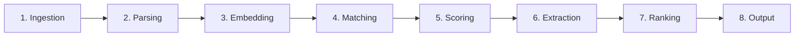
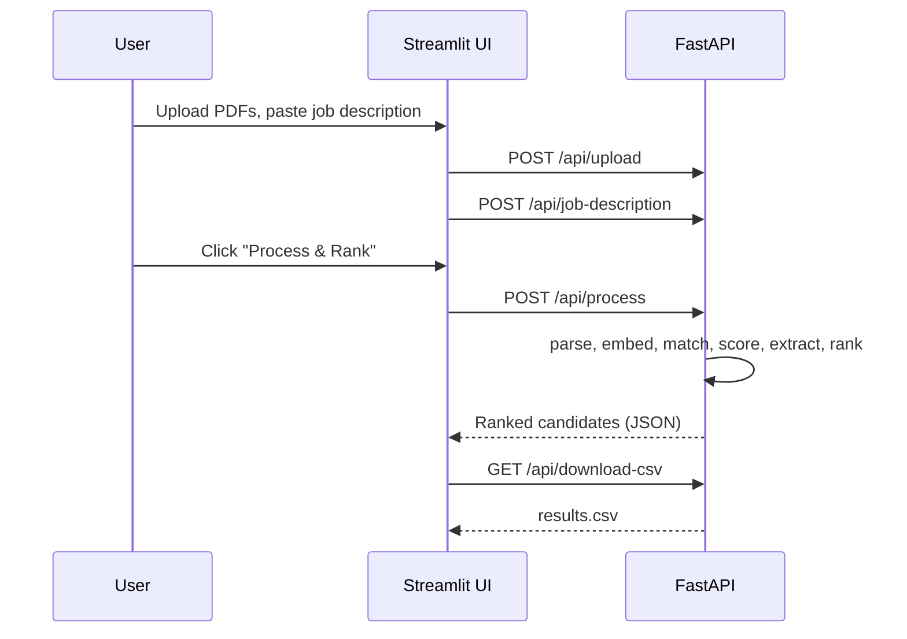

<div align="center">

# AI Resume Shortlister

**Rank a stack of resume PDFs against a job description in seconds, using local semantic search and a transparent, rule-based ATS score.**


[Quick start](#quick-start) ·
[How it works](#how-it-works) ·
[API reference](#api-reference) ·
[Limitations](#known-limitations) ·
[Beginner's guide](BEGINNER_GUIDE.md)

</div>

---

## Table of contents

- [Overview](#overview)
- [Features](#features)
- [How it works](#how-it-works)
- [Scoring methodology](#scoring-methodology)
- [Quick start](#quick-start)
- [Usage](#usage)
- [API reference](#api-reference)
- [Project structure](#project-structure)
- [Architecture notes](#architecture-notes)
- [Configuration and customization](#configuration-and-customization)
- [Tech stack](#tech-stack)
- [Known limitations](#known-limitations)
- [Privacy and responsible use](#privacy-and-responsible-use)
- [Troubleshooting](#troubleshooting)
- [Roadmap](#roadmap)
- [Contributing](#contributing)
- [License](#license)

---

## Overview

Screening hundreds of resumes by hand is slow and inconsistent. Classic keyword-based ATS tools are fast but brittle: they miss candidates who phrase skills differently from the job description, and they rarely explain their decisions.

**AI Resume Shortlister** combines two complementary signals:

1. **Semantic similarity** — resume and job description are embedded with a pre-trained transformer and compared with cosine similarity (via FAISS).
2. **Explainable ATS score** — a deterministic rubric for keyword coverage, section presence, length, and contact details. Matched and missing keywords are shown per candidate.

Everything runs **locally**. No resume text is sent to a third-party API. The only network call is the one-time download of the embedding model (about 80 MB).

> **Intended use:** decision *support* for a human reviewer. Scores are relative rankings, not hiring decisions. See [Privacy and responsible use](#privacy-and-responsible-use).

## Features

- Bulk PDF upload and text extraction (PyMuPDF)
- Semantic matching with `all-MiniLM-L6-v2` embeddings and FAISS
- Transparent ATS score with matched and missing keywords per candidate
- Structured extraction: name, email, phone, skills, education, years of experience
- Ranked results with a configurable shortlist threshold
- Card and table views in the dashboard, plus CSV export
- Documented REST API with interactive Swagger docs at `/docs`
- Modular package layout: one package per pipeline stage

<!-- TODO: add a screenshot or short GIF of the dashboard, e.g. docs/images/dashboard.png -->

## How it works

The backend runs an eight-stage pipeline. The Streamlit frontend is a thin HTTP client over the FastAPI backend.



| # | Stage | Package | Input | Output |
|---|-------|---------|-------|--------|
| 1 | Ingestion | `ingestion/` | Uploaded PDF bytes | Files in `temp_resumes/` |
| 2 | Parsing | `parsing/` | PDF path | Plain text |
| 3 | Embedding | `embeddings/` | Resume and JD text | 384-dimensional L2-normalized vectors |
| 4 | Matching | `matching/` | Resume vectors, JD vector | Similarity score (0–1) per resume |
| 5 | Scoring | `scoring/` | Text, JD, similarity | ATS score and final score (0–100) |
| 6 | Extraction | `extraction/` | Resume text | Name, email, phone, skills, education, experience |
| 7 | Ranking | `ranking/` | Scored candidates | Sorted list with `rank` |
| 8 | Output | `main.py` | Ranked list | JSON response and `outputs/results.csv` |

### Request flow



## Scoring methodology

**ATS score (0–100)** — rule-based and reproducible:

| Component | Weight | Rule |
|-----------|-------:|------|
| Keyword match | 60% | `matched JD keywords / total JD keywords`. Defaults to 50 if the JD contains no recognized keywords. |
| Section presence | 20% | Education, experience, skills, contact — 25 points each, detected by trigger words. |
| Resume length | 10% | 200–1000 words = 100; 100–199 or 1001–1500 = 70; otherwise 40. |
| Formatting | 10% | Email present (50) + phone present (50). |

**Final score (0–100):**

```
final_score = similarity × 100 × 0.6  +  ats_score × 0.4        (capped at 100)
```

**Worked example:** similarity `0.52`, ATS `82` → `52 × 0.6 + 82 × 0.4 = 31.2 + 32.8 = 64.0`.

> **Reading the numbers.** Cosine similarity between a resume and a job description typically lands well below 1.0 even for strong matches. Treat the final score as a **relative ranking within one batch**, not as a probability of fit. The 60/40 split is a sensible default, not an empirically tuned value; see [Configuration](#configuration-and-customization).

## Quick start

### Prerequisites

- Python 3.10 or newer
- About 2 GB of free disk space (PyTorch is a large dependency)
- Internet access on first run only (model download)

### Install

```bash
git clone https://github.com/<your-username>/<your-repo>.git
cd <your-repo>

python -m venv .venv
source .venv/bin/activate          # Windows: .venv\Scripts\activate

pip install -r requirements.txt
```

### Run

Use two terminals, both with the virtual environment activated.

```bash
# Terminal 1 — backend
uvicorn main:app --reload --port 8000

# Terminal 2 — frontend
streamlit run ui/app.py --server.port 8501
```

| Service | URL |
|---------|-----|
| Dashboard | http://localhost:8501 |
| API docs (Swagger) | http://localhost:8000/docs |
| Health check | http://localhost:8000/ |

The first processing run is slower because the embedding model is downloaded and loaded into memory. Later runs reuse the cached model.

## Usage

### Dashboard

1. Open http://localhost:8501 and confirm the sidebar shows **API Connected**.
2. Upload one or more PDF resumes.
3. Paste the job description.
4. Click **Process & Rank Candidates**.
5. Review results in card or table view. Adjust the **Shortlist Threshold** slider (default 60) to change which candidates are highlighted. The slider only affects display; it does not filter data.
6. Expand a candidate for matched and missing keywords, education, and experience.
7. Click **Download Results as CSV** to export.
8. Click **Clear All Data** before starting a new job posting.

### API (curl)

```bash
# 1. Upload resumes (repeat -F for multiple files)
curl -F "files=@alice.pdf" -F "files=@bob.pdf" http://localhost:8000/api/upload

# 2. Set the job description
curl -F "jd_text=Python developer with NLP and AWS experience" \
     http://localhost:8000/api/job-description

# 3. Run the pipeline
curl -X POST http://localhost:8000/api/process

# 4. Fetch results / download CSV
curl http://localhost:8000/api/results
curl -o results.csv http://localhost:8000/api/download-csv

# 5. Reset everything
curl -X DELETE http://localhost:8000/api/cleanup
```

## API reference

| Method | Endpoint | Description | Notes |
|--------|----------|-------------|-------|
| `GET` | `/` | Health check | Returns `{"status": "running"}` |
| `POST` | `/api/upload` | Upload PDFs (`multipart/form-data`, field `files`) | Non-PDF files are skipped |
| `POST` | `/api/job-description` | Store the JD (form field `jd_text`) | Held in server memory |
| `POST` | `/api/process` | Run the full pipeline | `400` if JD or resumes are missing; `409` if a run is in progress |
| `GET` | `/api/results` | Ranked candidates from the last run | |
| `GET` | `/api/download-csv` | Results as a CSV attachment | |
| `DELETE` | `/api/cleanup` | Delete uploaded PDFs and reset state | |

Interactive documentation is generated automatically at `/docs`.

### Candidate object

```json
{
  "rank": 1,
  "filename": "alice.pdf",
  "name": "Alice Example",
  "email": "alice@example.com",
  "phone": "+91 98765 43210",
  "skills": ["AWS", "Machine Learning", "Python"],
  "education": ["B.Tech in Computer Science"],
  "experience_years": "3+ years",
  "similarity_score": 52.0,
  "ats_score": 82.0,
  "final_score": 64.0,
  "matched_keywords": ["python", "aws", "machine learning"],
  "missing_keywords": ["docker", "kubernetes"]
}
```

## Project structure

```
.
├── main.py                 # FastAPI app: endpoints, AppState, pipeline orchestration
├── requirements.txt
├── ingestion/upload.py     # Save, list, and delete uploaded PDFs
├── parsing/parser.py       # PDF → text (PyMuPDF)
├── embeddings/embedder.py  # Singleton model loader; single and batch encoding
├── matching/matcher.py     # FAISS IndexFlatIP similarity search
├── scoring/scorer.py       # ATS rubric and final-score formula
├── extraction/extractor.py # Regex-based structured extraction
├── ranking/ranker.py       # Sorting, ranking, shortlist helpers
├── ui/app.py               # Streamlit dashboard
├── temp_resumes/           # Uploaded PDFs (transient; created at startup)
├── outputs/                # results.csv (created at startup)
├── BEGINNER_GUIDE.md       # Learning-oriented walkthrough
└── README.md
```

## Architecture notes

- **Client–server split.** Streamlit only talks to FastAPI over HTTP, so the UI can be replaced or deployed separately. Set `API_BASE` in `ui/app.py` to point at a remote backend.
- **One package per stage.** `main.py` is the only module that imports all stages; stages do not import each other. This keeps the dependency graph a simple star and makes each stage independently testable.
- **Hybrid scoring.** Embeddings capture meaning; the ATS rubric adds auditability. Either signal alone has known failure modes (see the [Beginner's Guide](BEGINNER_GUIDE.md#9-design-decisions-and-trade-offs)).
- **Model singleton.** `get_model()` loads `all-MiniLM-L6-v2` once per process and reuses it.
- **Exact search.** `IndexFlatIP` over L2-normalized vectors gives exact cosine similarity. At the scale this tool targets (tens to low thousands of resumes) it is more than fast enough.
- **Fault isolation.** A PDF that fails to parse returns an empty string and is skipped; it does not abort the batch.
- **In-memory state, no database.** The job description and results live in a process-level `AppState`. A `finally` block always resets the `is_processing` flag.

## Configuration and customization

| Goal | Where to change it |
|------|--------------------|
| Similarity / ATS weights | `similarity_weight` and `ats_weight` in `calculate_final_score()` (`scoring/scorer.py`) |
| Keywords used for ATS matching | `SKILL_KEYWORDS` in `scoring/scorer.py` (lowercase) |
| Skills shown on candidate cards | `KNOWN_SKILLS` in `extraction/extractor.py` |
| Ideal resume length bands | Length section of `calculate_ats_score()` |
| Embedding model | Model name in `get_model()` (`embeddings/embedder.py`). If the vector size changes, FAISS adapts automatically because it reads the dimension from the array. |
| Backend address used by the UI | `API_BASE` in `ui/app.py` |
| Default shortlist threshold | Slider default in `ui/app.py` |

Keep `SKILL_KEYWORDS` and `KNOWN_SKILLS` aligned: the first drives scoring, the second drives display.

## Tech stack

| Layer | Technology | Role |
|-------|-----------|------|
| API | FastAPI, Uvicorn, python-multipart | REST endpoints, file uploads, ASGI server |
| UI | Streamlit, pandas, requests | Dashboard, tables, HTTP client |
| PDF | PyMuPDF (`fitz`) | Text extraction |
| Embeddings | sentence-transformers, PyTorch | `all-MiniLM-L6-v2` (384 dimensions) |
| Search | FAISS (`faiss-cpu`), NumPy | Inner-product search on normalized vectors |
| Extraction | `re` (standard library) | Email, phone, name, education, experience patterns |

Dependencies in `requirements.txt` are specified as **minimum versions** (`>=`), not exact pins. For reproducible deployments, generate a lock file (for example with `pip freeze` or `pip-tools`).

## Known limitations

These are documented deliberately so you can judge fit before relying on the output.

| Area | Limitation | Impact |
|------|-----------|--------|
| Embedding input length | `all-MiniLM-L6-v2` truncates input at about 256 word-pieces (roughly the first 200 words) by default. | Content later in a long resume does not influence the similarity score. |
| Keyword matching | Matching is substring-based on lowercased text. | Short terms can false-match (for example `java` inside `javascript`). |
| Synonyms | The ATS keyword component does not know that "ML" means "Machine Learning". | Embeddings partly compensate; the keyword score does not. |
| Scanned PDFs | No OCR. Image-only PDFs yield no text and are skipped. | Add Tesseract or similar to support them. |
| File formats | PDF only. | DOCX and TXT are not supported. |
| Name extraction | Heuristic: first short, alphabetic line among the first seven. | May return the wrong line or `Unknown` on stylized layouts. |
| Single user | State is global to the server process; no authentication. | Do not expose directly to the public internet. |
| Upload handling | Files are stored under their original filename. | Same-named files overwrite each other; sanitize filenames (see below) before any shared deployment. |
| Leftover files | `/api/process` reads every PDF in `temp_resumes/`. | Stale files from earlier sessions are included until you clear data. |
| Validation | No automated test suite is documented. | Verify ranking quality on your own data before use. |

**Hardening tip for uploads:** store files using only the final path component, for example `Path(filename).name`, to prevent path traversal via crafted filenames.

## Privacy and responsible use

- Resumes contain personal data. Delete files with **Clear All Data** (or `DELETE /api/cleanup`) when finished. `outputs/results.csv` is **not** removed by cleanup; delete it separately if needed.
- Automated ranking can encode bias, for example through keyword choices or formatting preferences. Use scores to prioritize human review, never as the sole basis for rejecting a candidate.
- Check the hiring-automation regulations that apply in your jurisdiction before using any automated screening tool in production.

## Troubleshooting

| Symptom | Likely cause | Fix |
|---------|-------------|-----|
| Sidebar shows **API Offline** | Backend not running or wrong port | Start Uvicorn on port 8000 or update `API_BASE` |
| `ModuleNotFoundError: No module named 'embeddings'` | Missing `__init__.py` or wrong working directory | Run commands from the project root; keep `__init__.py` in every package |
| First run seems stuck | Model downloading | Wait; the cache lives in `~/.cache/huggingface/` |
| `409 Conflict` from `/api/process` | A run is already in progress | Wait for it to finish |
| `400 Bad Request` from `/api/process` | No JD or no uploaded PDFs | Upload resumes and set the JD first |
| Unexpected candidates in results | Old PDFs still in `temp_resumes/` | Click **Clear All Data** |
| Candidate shows `Unknown` name | Name heuristic did not match | Check the first lines of the extracted text |
| A resume is missing from results | PDF is scanned or corrupt (no extractable text) | Run OCR or re-export the PDF |

## Roadmap

- [ ] Unit tests for scoring, extraction, and ranking; CI workflow
- [ ] Word-boundary keyword matching and a synonym map
- [ ] Chunked embeddings (average or max over resume sections) to avoid truncation
- [ ] DOCX support and optional OCR for scanned PDFs
- [ ] Filename sanitization and upload size limits
- [ ] Per-session state instead of a global `AppState`
- [ ] Dockerfile and `docker compose` setup
- [ ] Configurable weights from the UI

## Contributing

Contributions are welcome.

1. Fork the repository and create a branch: `git checkout -b feat/short-description`
2. Keep changes focused; each pipeline stage should stay in its own package.
3. Add or update tests for behavior you change (see roadmap).
4. Use clear commit messages, preferably [Conventional Commits](https://www.conventionalcommits.org/) (`feat:`, `fix:`, `docs:`).
5. Open a pull request describing the problem, the approach, and how you verified it.

## License

Released under the [MIT License](LICENSE). Add a `LICENSE` file to the repository root if one is not already present.

## Further reading

- [BEGINNER_GUIDE.md](BEGINNER_GUIDE.md) — concepts, a full walkthrough of every module, exercises, and glossary
- [sentence-transformers documentation](https://www.sbert.net/)
- [FAISS wiki](https://github.com/facebookresearch/faiss/wiki)
- [FastAPI documentation](https://fastapi.tiangolo.com/)
- [Streamlit documentation](https://docs.streamlit.io/)
